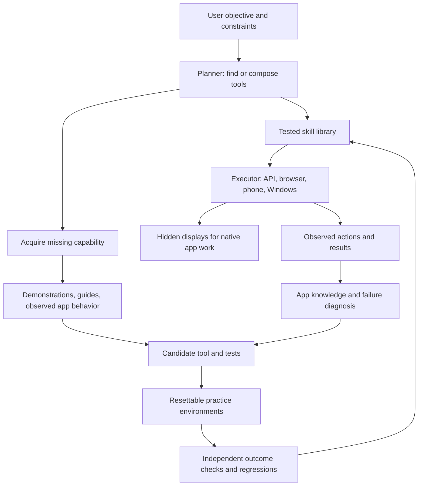

# Agent Bridge: learning to operate software

Research and working proposal — 20 September 2026, Pacific time.

**The proposed capability:** give Agent Bridge an unfamiliar piece of software and a useful objective. It learns enough of that software to do the work, saves the successful procedure as a parameterized and tested tool, improves it from subsequent experience, and composes it with tools learned elsewhere. The acquired capability belongs to Agent Bridge and can survive a change of model.

This is a proposed system, not a claim about today's implementation. The reviewed source is GitHub main at `0366635516341a626d388a27f895f5ac0ca84350`. Research below supports individual ingredients; it does not demonstrate this complete system on George's phone.

**What changes in the ambition**

The hidden screen is valuable because a native app can have a working foreground without occupying the physical panel. That provides an execution environment. The larger capability comes from connecting it to observation, knowledge acquisition, tool synthesis, testing, composition, and continuing improvement.

A useful target is: "Learn how to collect records from this app. Now combine that with the files on my laptop and prepare the comparison. When the app changes, repair the skill and preserve the old evidence." The user supplies the desired result. The system increasingly supplies its own integrations.

The research-backed bet is that a growing, tested library of app operations can improve useful capability with a fixed base model. That is learning in external knowledge and programs. Updating neural-network weights is a separate, later option.

**Six capabilities to build toward**

| Capability | Concrete behavior | How Agent Bridge could acquire it | Confidence in this proposal |
|---|---|---|---|
| Learn unfamiliar software | Discover how to search, filter, edit, export, and verify results in a previously unsupported app | Task-directed exploration, app documentation, observed transitions, demonstration when necessary | Strong engineering direction; arbitrary-app coverage remains unproven |
| Turn an app into a tool | Expose `collect_records(query, date_range)` with typed results and evidence | Compile successful procedures into guarded programs with parameters and postconditions | Strong starting point; generated tools need evaluation |
| Learn a person's method | Reproduce the user's conventions while changing dates, files, and entities | Demonstration -> infer variable inputs and invariants -> test new cases | Promising; genuine variant transfer is a central research question |
| Combine capabilities | Join a phone-only workflow, a browser workflow, and Windows file processing into one objective | Common typed inputs/outputs plus a planner that checks preconditions | Buildable for bounded combinations; broad generality needs testing |
| Improve through practice | Diagnose recurring failure, generate a useful exercise, revise a candidate skill, retain only improvements | Resettable practice environments, independent verifiers, regression tests | Strong direction for external skills; autonomous curriculum remains experimental |
| Preserve and transfer competence | A different model can reuse the tools and knowledge; UI changes trigger repair of affected skills | Model-neutral skill contracts, versioned knowledge, provenance, compatibility tests | Supported by adjacent research; must be measured on Agent Bridge |

These capabilities can support longer-lived objectives. For example, "keep this set of records reconciled" becomes a standing desired state: the controller detects relevant changes, chooses existing tools, handles the delta, and records proof. This should be added after single-run competence is measured. It does not require inventing a new goal whenever a notification arrives.

**Research that changes the design**

This selection prioritizes methods with a direct consequence for Agent Bridge. Most very recent entries are preprints; workshop papers are identified separately. Institutions are taken from the papers rather than inferred from authors' names. New 2026 work is central, with older work retained where it supplies a useful implementation pattern.

| Work and date | What the evidence supports | What to take into Agent Bridge | Evidence boundary |
|---|---|---|---|
| [EvoSkill-GUI, Zhejiang University, 15 Sep 2026](https://arxiv.org/html/2609.17653v1) | A fixed model executes, diagnoses failures in a separate context, and revises structured GUI skills. An appendix reports 22/30 held-out tasks versus 12/30 for a pass@3 baseline; gains include both retrieved and newly created skills. | Maintain editable skill packages and isolate failure diagnosis from the executor's rationale. | Fresh preprint; small held-out sample, additional inference, imperfect critic. This is not proof of unlimited self-improvement. |
| [WikiSkill, Google Research / Virginia Tech, 27 Aug 2026](https://arxiv.org/html/2608.27454v1) | Separates raw traces, persistent knowledge, and executable skills; reports cross-model skill transfer. | Three stores: evidence, learned app knowledge, and callable skills. | Its five benchmarks include reasoning, document work, spreadsheets, and ALFWorld, not native Android GUI deployment. Applying it here is an inference. |
| [UI-Mate, Tencent, 16 Aug 2026](https://arxiv.org/html/2608.15930v1) | Demonstration-conditioned desktop operation with released model artifacts. The reported demonstration gains use same-task demonstrations; systematic results for the 45 related-task demonstration pairs remain future work. | Capture demonstrations with state and intent; test whether the procedure survives new entities and layouts. | Do not present the headline improvement as established one-shot transfer to different tasks or Android apps. |
| [MMG2Skill, 1 Jun 2026](https://arxiv.org/html/2606.01993v1) | Converts heterogeneous human guides into editable skills and revises them from observed trajectories. Raw-guide prompting can perform worse than structured processing. | A capability acquisition tool that searches documentation/tutorials, extracts a candidate procedure, and validates it. | Benchmark evidence across several domains; live production app coverage is not established. |
| [ACuRL, Ohio State / UC Berkeley, 10 Feb 2026](https://arxiv.org/html/2602.10356v1) | Agents explore environments, generate tasks suited to their current ability, and adapt through RL. | Generate practice tasks from actual observed capabilities and failure history. | The reported training uses eight H100 GPUs plus a substantial environment host. Borrowing its curriculum idea for external skills does not reproduce its RL result. |
| [K²-Agent, Tsinghua / Huawei / CAS, 28 Feb 2026](https://arxiv.org/html/2603.00676v1) | Separates task knowledge from low-level execution; investigates transfer of each. Its executor is trained. | Keep general task strategy separate from per-app interaction mechanics. | Gains do not come from a free prompt change; published results include learned weights. |
| [AutoDroid-V2, Tsinghua-led, 2025 revision](https://arxiv.org/html/2412.18116v2) | Builds app-specific documentation and generates multi-step executable scripts. | Turn discovered app behavior into documented operations and guarded executable programs. | Earlier work, not a new September result. Its trained model and interpreter matter; blind tap batching is not equivalent. |
| [TRISHUL, Fractal AI Research, India, CVPR 2025 workshop](https://openaccess.thecvf.com/content/CVPR2025W/MULA2025/papers/Singh_TRISHUL_Towards_Region_Identification_and_Screen_Hierarchy_Understanding_for_Large_CVPRW_2025_paper.pdf) | Hierarchical screen parsing and spatial descriptions improve GUI comprehension without task-specific training. | When accessibility is poor, represent regions, labels, relationships, and candidate actions rather than asking for an isolated coordinate. | Grounding and referring evidence; not an end-to-end lifelong operator. Included for relevance, not recency. |
| [Scaling Agents for Computer Use / Agent S3, Simular, 2025; journal acceptance reported 2026](https://arxiv.org/abs/2510.02250) | Multiple attempts plus behavior-based selection improve computer-use benchmarks; coding and GUI actions can share a workflow. | Compare alternative approaches in genuinely isolated resettable environments; retain the best verified procedure. | Additional attempts cost more. Parallel virtual displays sharing one live account are not independent trial copies. [Acceptance announcement](https://www.simular.ai/research). |
| [How Mobile World Model Guides GUI Agents?, May 2026](https://arxiv.org/html/2605.10347v2) | Compares text, images, and rendered-code predictions of future screens. Prediction format and deployment distribution affect usefulness; post-hoc reflection is not a universal improvement. | Start with predictions of semantic state changes to help select actions, then compare prediction with reality. | A predicted success is not proof of a real result. Longer synthetic training can regress. |
| [BlueLM-GUI, 11 Sep 2026](https://arxiv.org/html/2609.12394v1) | A large mobile-agent training effort using device rollouts and correction of failed trajectories. | Preserve failures as reusable evidence; improve task coverage as old tests become easy. | Industrial-scale resources: the training appendix describes 32 GPUs and hundreds of devices, with emulators also mentioned. This is not a laptop-sized recipe. |
| [SkillsBench 1.1, 2026](https://www.skillsbench.ai/blogs/skillsbench-1-1) | Paired evaluations find benefits from curated skills but negative changes from upfront self-generated skills in the reported configurations. | Require measured improvement before admitting a generated skill; retain a no-skill baseline. | Upfront skill writing and learning from validated interaction are different methods. This is a counterexample to automatic benefit, not a proof that experience-based learning cannot work. |
| [MobileWorld, ACL 2026](https://aclanthology.org/2026.acl-long.278/) | Evaluates mobile agents using longer workflows, user interaction, and GUI/tool combinations. | Test hybrid API/GUI operations and whole objectives, rather than only single-screen taps. | Benchmark environments differ from the owner's Samsung and real production accounts. |

The [EvoSkill-GUI repository](https://github.com/ZJU-REAL/EvoSkill-GUI) is available under Apache-2.0. Its package format and restricted revision interface are useful starting references. This proposal does not assume its benchmark integration can be dropped unchanged into Agent Bridge. The [ACuRL repository](https://github.com/OSU-NLP-Group/ACuRL) is also available; its compute requirements make direct reproduction a different project.

I found EARL, an India/Germany collaboration on early intent recognition, but direct access to the full OpenReview paper was blocked by its verification page. It is not used as evidence for the proposed design. The India contribution relied on here is the accessible TRISHUL paper.

**Three approaches, and the choice**

| Approach | What we would build | Advantage | Tradeoff |
|---|---|---|---|
| External learning with existing models — recommended first | Evidence store, app knowledge, generated tools, testing, and revision on top of current control paths | Directly tests whether Agent Bridge gets better with experience; model can be changed independently | Quality depends on verifiers, retrieval, and transfer; inference still costs money |
| Specialized executor plus external learning | Add an open GUI model for frequent perception/actions, retain a stronger planner for unfamiliar work | Potential latency/cost improvement and greater local control | Requires hosting, hardware measurements, compatibility work, and possibly fine-tuning |
| Train a general mobile operator | Large rollout infrastructure, data curation, RL, continual evaluation, model serving | Greater control over the learned policy and research frontier | Major compute/device project; reproducing a paper is not proof it works on George's apps |

The recommended architecture preserves the option to take the other two routes later. It starts collecting the structured data and evaluation results that would make a training investment informed.

**Proposed architecture**

These are logical modules, not a requirement to run a separate model process for every box. Start with sequential calls in one controller. Add concurrency only where work and state are independent and the operator has enabled it.

The controller needs six interfaces:

1. `observe(workspace)` returns a fresh, versioned representation of the app, screen, objects, and available actions. Screenshots and accessibility metadata complement each other. The current identity, app version, account context, and display generation travel with the observation.
2. `execute(skill, arguments, workspace)` runs an admitted skill, checking current state at branch points. It can mix an API call, a browser operation, a native app action, and a file transformation. It returns typed output, evidence, and a completion state.
3. `acquire(goal, environment, evidence)` generates a candidate capability from demonstrations, guides, observed transitions, and missing knowledge. External content is evidence to inspect, not an instruction to change the controller's goals or privileges.
4. `evaluate(candidate, suite)` checks new task instances and old known cases in resettable environments. The candidate cannot edit its held-out test answers or scoring rules.
5. `revise(candidate, failure)` proposes a localized change with cited observations. The failure analyst sees the task and actual trajectory, not a persuasive story about why the executor thought it was right.
6. `promote(candidate)` admits a version only when the fixed evaluation rule passes. The prior version remains available. A schema-valid tool can still be behaviorally wrong, so type checking is necessary but insufficient.

**What gets learned and stored**

Raw evidence records what was observed and attempted. App knowledge captures what the evidence supports: where a function lives, what a field means, which actions change state, what version a fact applies to, and what remains unknown. Skills implement parameterized operations using that knowledge. Personal conventions are stored separately from generic app mechanics so they can be changed without rewriting every tool.

A useful skill is more than a text recipe. It carries:

- Its purpose, typed inputs and outputs, and applicability conditions.
- Required app/account/workspace context and exclusive resources.
- A program or workflow with live-state branches, explicit completion checks, and recoverable checkpoints.
- Rules for uncertain outcomes and actions that cannot simply be repeated.
- Example evidence, failure cases, tests, compatibility versions, measured cost, and observed success history.
- Parent versions and a traceable explanation for each revision.

One proposed example is `collect_records(query, date_range) -> records + evidence`. It does not hardcode the names or dates from its teaching example. It must read current records, distinguish similarly named entities, traverse all relevant pages, detect completion, and return source-backed results. The same interface could have a native-app implementation and a browser implementation. A planner selects among them by tested compatibility and cost.

Learning an app-wide API is incremental. A single successful task does not establish an entire app's semantics. The system expands its operation catalog when user objectives demand new functions, and marks unsupported conditions explicitly.

**Planning at the level of outcomes**

The planner reasons over inputs and effects: which tool can produce the file or record needed by the next tool, and which conditions must hold before it runs. This enables new combinations of existing capabilities. For example, a mobile collection skill returns a normalized dataset; a Windows document skill consumes it; a browser skill places the resulting draft in a portal.

Novelty can therefore come from composition before the system learns a new primitive. When an operation is missing, the acquisition module investigates just that gap. It can also write a small adapter or data-transforming program and test it. It should not invent an API endpoint or assume an undocumented export exists.

This is a reasonable place to explore a semantic world model: a record of objects, relations, and predicted action effects. Initially it is explicit and evidence-backed. Neural next-screen prediction is an optional later component. Predictions help choose a plan; observed state decides whether the plan worked.

**Work environments versus practice environments**

Hidden displays are work environments on the same Android installation. They share app processes, account data, and server-side effects. They cannot rewind a submission, duplicate arbitrary app state, or make simultaneous trials independent.

Practice needs a separate facility: emulator snapshots where supported, VM snapshots for desktop software, resettable browser test services, disposable app data, and controlled test accounts. A snapshot still cannot undo a real server-side operation. Each environment must declare what reset actually restores.

A later experiment could synthesize a limited mock application from observed layouts and transitions to test control logic cheaply. Its tests would establish behavior in the mock, not compatibility with the real app. Keep this distinct from a genuine device snapshot and from a neural prediction of a future screen.

The phone remains the final compatibility target. Practice results have to transfer back to its actual app versions, focus behavior, input method, display layout, and accessibility environment.

**How practice could become self-directed**

Track capability gaps by task family. If list traversal works but date filtering fails, generate exercises that isolate filtering before asking for longer workflows. Select exercises by expected usefulness to real requests, uncertainty, learning progress, and cost. Reserve some older tasks to detect regression.

After a failure, determine whether it was lack of knowledge, poor perception, bad planning, transport failure, stale state, or an invalid task. Only skill-related failures should rewrite a skill. A disconnected phone is not evidence that the agent misunderstood the app.

Skill growth needs pruning. Merge duplicate tools, retire incompatible versions, and keep retrieval focused. A large library can make selection worse; competence is measured by held-out completion and cost, not by the number of files generated.

**Where this attaches to the existing repository**

All source links below are pinned to the reviewed commit. Suggested new paths are proposals, not existing files.

| Existing component | What was verified in source | Proposed extension |
|---|---|---|
| [conductor_brain.py](https://github.com/gugosf114/agent-bridge/blob/0366635516341a626d388a27f895f5ac0ca84350/scripts/conductor_brain.py#L499) | A model tool loop with 28 named tools. `save_playbook` writes a textual memory entry, capped at 1,500 characters; the named tools have no hidden-display-specific interface. | Route to a typed skill registry; add capability discovery and an explicit hidden-workspace adapter. Existing generic tool execution does not establish this integration. |
| [task store](https://github.com/gugosf114/agent-bridge/blob/0366635516341a626d388a27f895f5ac0ca84350/runtime/task-engine/agent_bridge_task/store.py#L79) and [engine](https://github.com/gugosf114/agent-bridge/blob/0366635516341a626d388a27f895f5ac0ca84350/runtime/task-engine/agent_bridge_task/engine.py#L108) | SQLite recipes/events/tasks, resource locks, and semantic postcondition handling. | Add skill versions, episode references, candidate evaluation, and a hidden-screen adapter. Existing checkpoints are a starting point, not a guarantee of exactly-once external effects. |
| [app_map.py](https://github.com/gugosf114/agent-bridge/blob/0366635516341a626d388a27f895f5ac0ca84350/scripts/app_map.py#L85) | Screen fingerprints and recorded transitions. | Evolve into app knowledge with meaningful state, account context, observed preconditions/effects, and confidence. |
| [teach_skill.sh](https://github.com/gugosf114/agent-bridge/blob/0366635516341a626d388a27f895f5ac0ca84350/scripts/teach_skill.sh#L54) | Photo-template replay. | Add multimodal demonstrations with intent, variable extraction, and generated tests. Preserve recordings as evidence; do not confuse literal replay with generalization. |
| [UD.java](https://github.com/gugosf114/agent-bridge/blob/0366635516341a626d388a27f895f5ac0ca84350/tools/hidden-display/UD.java) and [VD.java](https://github.com/gugosf114/agent-bridge/blob/0366635516341a626d388a27f895f5ac0ca84350/tools/hidden-display/VD.java) | Accessibility observation and virtual-display creation. | One shared observer serving fresh per-display state; correlated input and capture. These are the sensor/actuator substrate for the learning loop. |
| [toolkit-dispatch](https://github.com/gugosf114/agent-bridge/blob/0366635516341a626d388a27f895f5ac0ca84350/portable/toolkit-dispatch) | Existing entry points for browser and other tools. | Reuse current adapters in composed skills; keep the frozen bridge transport files intact. |

Suggested new modules: `runtime/skill-engine/` for contracts, retrieval and versions; `runtime/experience/` for episodes and knowledge; `runtime/learning/` for acquisition and candidate revision; `runtime/practice/` for reset adapters and scoring; and `runtime/task-engine/agent_bridge_task/hidden_adapter.py` for the device interface. Final file boundaries should follow the first experiment's actual dependencies.

**The first convincing demonstration**

Choose three controllable apps and a small set of functions that compose. Teach or discover a few operations using training examples. Then give the agent new records, dates, starting screens, and combinations it has never practiced. Keep the underlying model fixed.

The demonstration succeeds only if the learned library improves new-task completion over the same agent without learning, saves useful work, and avoids regression on previously solved tasks. Swap the model afterward to test whether the acquired competence is portable. Change an app layout or insert a modal, then test whether an observed failure produces a revision that helps new cases.

The companion `EXPERIMENT-01.md` specifies the task split, comparisons, measurements, and promotion rules. It is deliberately built to falsify the idea if the system is merely memorizing demonstrations.

**Build sequence, with a result at every stage**

1. Record replayable episodes and build the test harness. Result: we can inspect what happened and score task completion from actual state.
2. Add parameterized skills plus a baseline executor. Result: an operation learned once is callable on new data, with the same model and budget as the baseline.
3. Add failure diagnosis and candidate revision. Result: a measured improvement on unseen instances, with prior behavior retained.
4. Add guide/demo acquisition and tool export. Result: an unsupported app operation becomes a tested capability without a hand-written integration for that specific operation.
5. Add cross-app and cross-device composition. Result: a new objective is solved by combining previously learned operations.
6. Add curriculum and model portability. Result: the system selects useful practice, and another model can reuse what was learned.
7. Consider a specialized executor or weight training after the data shows a stable bottleneck. Result: a measured cost, latency, or completion advantage that survives the full regression suite.

Stages 1–3 form the first buildable slice. Stage 4 tests capability acquisition. Stages 5–6 test the larger ambition. They are acceptance stages, not promises that every app will fit.

**Resources and spending**

The recommended first route uses hosted models and a resettable test environment, with no GPU training. Actual cost depends on screenshots, trajectory length, retries, and model prices at execution time. Make a ten-run calibration before estimating a full benchmark. Planning allowances could be $50 for a small pilot and $250 for a larger evaluation; these are proposed spending caps, not vendor quotes or predicted bills. No paid experiment was run for this report.

The first pilot below contains 36 evaluation runs plus library-building and diagnosis calls. The expanded study contains 270 runs plus learning. Cost must include failed attempts and library construction. Compare amortized cost at stated reuse counts rather than calling learning free. Local hosting or GPU rental is a separate route to price after measuring the executor's actual requirements.

**What would justify going much further**

Evidence that an unchanged base model gets better at unseen tasks, learns missing app operations, retains older skills, transfers its library to another model, and combines operations across devices would justify investing in an enduring software operator. That is materially larger than a hidden-screen macro system.

If improvements disappear on new records or layouts, work on representation and testing before expanding the app fleet. If the library helps but primitive interaction dominates failures, invest in the executor. If verification dominates failures, improve observability. Let measured limitations determine the next research investment.

The full ceiling remains an open research question. The proposed architecture makes progress toward it measurable, and keeps the useful intermediate capabilities even if the most ambitious learning experiments fail.

**Research provenance**

Primary papers, author repositories, model cards, and official proceedings were checked online. Search covered US, Chinese, Indian, and other relevant work, with a recency focus through 20 September 2026. Technical summaries above are selective, not an exhaustive literature review or independent replication. No published leaderboard scores are treated as expected performance on Agent Bridge. All proposed modules, examples, evaluation thresholds, and cost caps are design judgments.
